# Hi, I'm DivyaKumar Patel 👋

### Software Developer | Backend Engineering | Flutter | AI & Agentic Systems

I enjoy building scalable applications, optimizing backend systems, and exploring AI-powered solutions to real-world problems.

- 💻 Interested in backend engineering, distributed systems, and scalable applications.
- 🚀 Experienced in building cross-platform applications using Flutter and Dart.
- 🤖 Exploring LLM applications, AI agents, and Model Context Protocol (MCP).
- 🌱 Always learning, building, and contributing to interesting projects.

## 💻 Technical Skills

### Programming Languages

### Frameworks & AI Technologies

### Databases & Backend Technologies

### Tools & Cloud

---

## 📊 GitHub Statistics

<picture>
  <source media="(prefers-color-scheme: dark)" srcset="./assets/profile-cards/overview.dark.svg" />
  
</picture>

<picture>
  <source media="(prefers-color-scheme: dark)" srcset="./assets/profile-cards/contributions.dark.svg" />
  
</picture>

<picture>
  <source media="(prefers-color-scheme: dark)" srcset="./assets/profile-cards/languages.dark.svg" />
  
</picture>

<!-- <picture>
  <source media="(prefers-color-scheme: dark)" srcset="./assets/profile-cards/lifetime.dark.svg" />
  
</picture> -->

<!-- <picture>
  <source media="(prefers-color-scheme: dark)" srcset="./assets/profile-cards/rhythm.dark.svg" />
  
</picture> -->

<!-- <picture>
  <source media="(prefers-color-scheme: dark)" srcset="./assets/profile-cards/repositories.dark.svg" />
  
</picture> -->

## 🎯 Current Focus

- Backend Engineering & System Design
- Distributed Systems & Database Optimization
- AI Agents, LangGraph & MCP
- Building practical AI-powered applications

## 🌐 Connect With Me

⭐ *I believe in learning by building and improving through experimentation.*
